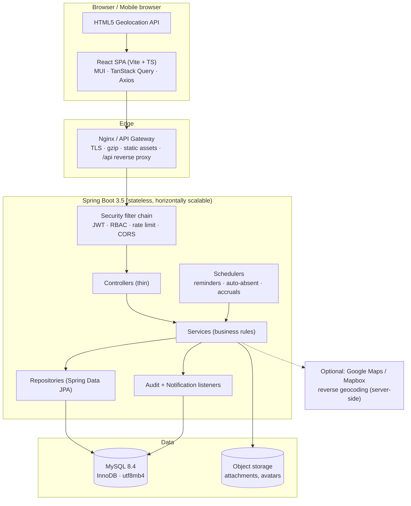
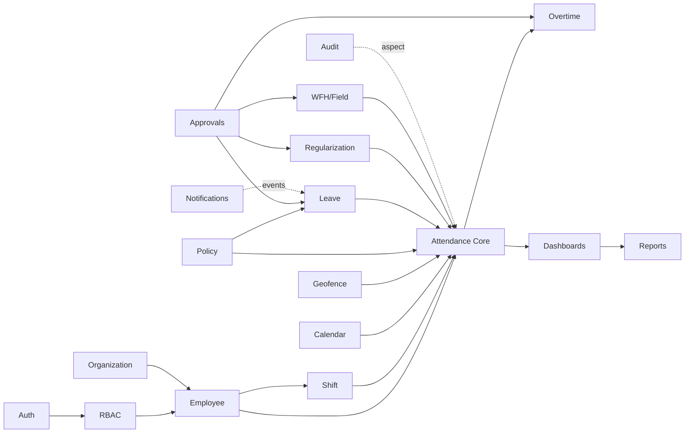

# 01 — System Architecture

## 1.1 Deployment topology



**Why stateless:** no HTTP session, no sticky sessions. Any instance serves any request, so scaling to thousands of employees means adding instances behind the load balancer. The only shared mutable state is MySQL (and Redis later, for rate limiting and the policy cache — see §1.6).

## 1.2 Backend layering

```
HTTP request
  -> Filter chain        JwtAuthenticationFilter, RateLimitFilter, RequestIdFilter, CORS
  -> Controller          @Valid request DTO, @PreAuthorize, no business logic, returns ApiResponse<T>
  -> Service (interface) transaction boundary, orchestration, policy resolution, domain rules
  -> Repository          Spring Data JPA + Specifications for dynamic filters
  -> Entity              JPA entities; NEVER serialized to HTTP
  -> MySQL
```

Rules enforced in review:

- Controllers may not reference `Repository` or `Entity` types.
- `@Transactional` lives on the service implementation, never on the controller.
- Mapping via MapStruct (`entity <-> DTO`); no entity leaves the service layer.
- Cross-cutting concerns are aspects/listeners, not inline code: `@Auditable` AOP writes `audit_logs`; Spring `ApplicationEvent` drives notifications.

### Transaction boundaries that matter

| Operation | Boundary | Concurrency control |
|---|---|---|
| Punch-in | `@Transactional` | `UNIQUE(employee_id, attendance_date)` — a duplicate insert raises `DataIntegrityViolationException`, translated to `ALREADY_PUNCHED_IN` |
| Punch-out / break | `@Transactional` | `SELECT … FOR UPDATE` on the attendance row (pessimistic write lock) |
| Leave apply | `@Transactional` | `@Version` optimistic lock on `leave_balances`; single retry on conflict |
| Leave approve | `@Transactional` | Row lock on `leave_requests` + balance version check; blocks double-approval from two tabs |
| Nightly jobs | Chunked, per-employee transactions | **ShedLock** so exactly one instance runs each scheduled job |

## 1.3 Module breakdown

| # | Module | Responsibility | Key tables |
|---|--------|----------------|------------|
| M01 | **Auth & Identity** | Login, JWT issue/refresh/rotate, logout, forgot/reset/change password, lockout, activation | `users`, `refresh_tokens`, `password_reset_tokens`, `login_attempts` |
| M02 | **RBAC** | Roles, permissions, role↔permission and user↔role assignment, method-level authorization | `roles`, `permissions`, `user_roles`, `role_permissions` |
| M03 | **Employee** | Employee CRUD, activate/deactivate, bulk CSV/Excel import, profile & photo | `employees`, `employee_managers` |
| M04 | **Organization** | Departments, designations, offices, office locations, reporting hierarchy | `departments`, `designations`, `offices`, `office_locations` |
| M05 | **Shift** | Shift masters, effective-dated employee/department assignment, rotation | `shifts`, `employee_shifts` |
| M06 | **Calendar** | Holidays, per-location holiday calendars, optional-holiday opt-in, weekly-off rules | `holidays`, `holiday_calendars`, `holiday_calendar_entries`, `employee_optional_holidays`, `weekly_offs` |
| M07 | **Attendance Core** | Punch in/out, breaks, working-hour computation, late/early/OT derivation, daily status | `attendance`, `attendance_punch_events`, `attendance_breaks`, `break_types` |
| M08 | **Geofencing** | Haversine distance, radius validation, accuracy gate, work-mode exemptions, suspicious-punch flags | `office_locations`, `location_policies` |
| M09 | **Leave** | Leave types, quotas, balances, accrual, apply/approve/reject/cancel, multi-level workflow | `leave_types`, `leave_policies`, `leave_balances`, `leave_requests`, `leave_request_days`, `leave_approvals` |
| M10 | **Regularization** | Attendance correction requests, before/after snapshot, approval, day re-derivation | `attendance_regularizations`, `regularization_approvals` |
| M11 | **WFH & Field** | WFH request/approval, field-attendance capture, work-mode-aware location rules | `work_from_home_requests`, `wfh_approvals` |
| M12 | **Overtime** | OT derivation from shift + policy, approval, OT reporting | `overtime_records`, `overtime_policies` |
| M13 | **Approvals** | Shared engine: level resolution from hierarchy, routing, escalation, delegation | the `*_approvals` tables |
| M14 | **Policy & Settings** | Attendance/leave/location/overtime policies, scope resolution, company settings | `attendance_policies`, `policy_assignments`, `company_settings` |
| M15 | **Dashboards** | Employee / Manager / HR / Admin aggregates and charts | read-only projections |
| M16 | **Reports** | 12 report types, filters, streamed Excel/CSV/PDF export | read-only projections |
| M17 | **Notifications** | In-app notifications, templates, channel-agnostic dispatcher | `notifications`, `notification_templates` |
| M18 | **Scheduler** | Punch reminders, auto-absent marking, missing-punch alerts, leave accrual, carry-forward, rollups | — |
| M19 | **Audit** | Old/new value capture on every critical mutation | `audit_logs` |
| M20 | **Announcements** | Company announcements on dashboards | `announcements` |

### Module dependency direction



No cycles: Attendance Core never imports Reports; Notifications never imports Leave (it consumes published events).

## 1.4 User roles

| Role | Data scope | Description |
|------|-----------|-------------|
| `EMPLOYEE` | Self | Punch, breaks, own attendance/leave/regularization/WFH, own profile |
| `MANAGER` | Reporting subtree | Everything EMPLOYEE has, plus team attendance, L1 approvals, team reports |
| `HR` | Organization | Employee & master-data management, org-wide attendance/leave administration, L2 approvals, all reports, holiday/shift/leave-type config |
| `ADMIN` | Organization + system config | Everything HR has, plus roles, permissions, offices, geofences, policies, company settings, audit logs |
| `SUPER_ADMIN` | System | Everything ADMIN has, plus the permission catalogue, role creation, break-glass access, data-retention actions |

Roles are additive — a user may hold `EMPLOYEE` + `MANAGER`.

**Manager authority comes from the hierarchy, not the role.** Holding `MANAGER` grants the *ability* to approve; `employee_managers` decides *whose* requests appear. Both are checked on every approval action.

### Data-scope enforcement

Three tiers on every read of employee-scoped data:

1. **Endpoint** — `@PreAuthorize("hasAuthority('LEAVE_APPROVE_L1')")`
2. **Scope** — `AccessScopeResolver` derives `SELF` | `TEAM` | `ORG` from the principal's roles
3. **Row** — the service applies it: `SELF` → `employeeId = principal`; `TEAM` → `employeeId IN (reporting subtree)`; `ORG` → unrestricted

Never the path variable alone. `GET /api/v1/employees/{id}/attendance` with someone else's id returns `403 ACCESS_DENIED` unless the scope check passes.

## 1.5 Permission catalogue and role matrix

Permissions are `MODULE_ACTION` codes stored in `permissions`, granted to roles, and loaded into the JWT as authorities at login.

| Permission | EMPLOYEE | MANAGER | HR | ADMIN | SUPER_ADMIN |
|---|:-:|:-:|:-:|:-:|:-:|
| `ATTENDANCE_PUNCH` | ✔ | ✔ | ✔ | ✔ | ✔ |
| `ATTENDANCE_VIEW_SELF` | ✔ | ✔ | ✔ | ✔ | ✔ |
| `ATTENDANCE_VIEW_TEAM` | — | ✔ | ✔ | ✔ | ✔ |
| `ATTENDANCE_VIEW_ALL` | — | — | ✔ | ✔ | ✔ |
| `ATTENDANCE_EDIT` | — | — | ✔ | ✔ | ✔ |
| `ATTENDANCE_LOCK` | — | — | ✔ | ✔ | ✔ |
| `LEAVE_APPLY` | ✔ | ✔ | ✔ | ✔ | ✔ |
| `LEAVE_APPROVE_L1` | — | ✔ | ✔ | ✔ | ✔ |
| `LEAVE_APPROVE_L2` | — | — | ✔ | ✔ | ✔ |
| `LEAVE_CANCEL_ANY` | — | — | ✔ | ✔ | ✔ |
| `LEAVE_BALANCE_ADJUST` | — | — | ✔ | ✔ | ✔ |
| `LEAVE_TYPE_MANAGE` | — | — | ✔ | ✔ | ✔ |
| `REGULARIZATION_APPLY` | ✔ | ✔ | ✔ | ✔ | ✔ |
| `REGULARIZATION_APPROVE_L1` | — | ✔ | ✔ | ✔ | ✔ |
| `REGULARIZATION_APPROVE_L2` | — | — | ✔ | ✔ | ✔ |
| `WFH_APPLY` | ✔ | ✔ | ✔ | ✔ | ✔ |
| `WFH_APPROVE` | — | ✔ | ✔ | ✔ | ✔ |
| `OVERTIME_APPROVE` | — | ✔ | ✔ | ✔ | ✔ |
| `EMPLOYEE_VIEW_SELF` | ✔ | ✔ | ✔ | ✔ | ✔ |
| `EMPLOYEE_VIEW_TEAM` | — | ✔ | ✔ | ✔ | ✔ |
| `EMPLOYEE_VIEW_ALL` | — | — | ✔ | ✔ | ✔ |
| `EMPLOYEE_CREATE` / `_UPDATE` / `_DEACTIVATE` | — | — | ✔ | ✔ | ✔ |
| `EMPLOYEE_BULK_IMPORT` | — | — | ✔ | ✔ | ✔ |
| `DEPARTMENT_MANAGE` / `DESIGNATION_MANAGE` | — | — | ✔ | ✔ | ✔ |
| `SHIFT_MANAGE` / `SHIFT_ASSIGN` | — | — | ✔ | ✔ | ✔ |
| `HOLIDAY_MANAGE` | — | — | ✔ | ✔ | ✔ |
| `REPORT_VIEW_TEAM` | — | ✔ | ✔ | ✔ | ✔ |
| `REPORT_VIEW_ALL` / `REPORT_EXPORT` | — | — | ✔ | ✔ | ✔ |
| `OFFICE_MANAGE` / `GEOFENCE_MANAGE` | — | — | — | ✔ | ✔ |
| `POLICY_MANAGE` / `SETTINGS_MANAGE` | — | — | — | ✔ | ✔ |
| `ROLE_MANAGE` / `USER_ROLE_ASSIGN` | — | — | — | ✔ | ✔ |
| `AUDIT_VIEW` | — | — | — | ✔ | ✔ |
| `PERMISSION_MANAGE` | — | — | — | — | ✔ |
| `DATA_RETENTION_MANAGE` | — | — | — | — | ✔ |

Seeded by Flyway (`V6__seed_roles_permissions.sql`) and editable at runtime by `ADMIN`/`SUPER_ADMIN`. The matrix is the *default*, not a compile-time constant.

## 1.6 Cross-cutting infrastructure

| Concern | Implementation |
|---|---|
| Response envelope | `ApiResponse<T>{success, message, data, errorCode, timestamp, path, traceId}` |
| Exceptions | `@RestControllerAdvice GlobalExceptionHandler` maps every custom exception to an HTTP status + `ErrorCode` enum value |
| Validation | Jakarta Bean Validation on request DTOs, plus `@Validated` service checks for cross-field rules |
| Logging | SLF4J + Logback JSON encoder; `RequestIdFilter` puts `traceId`/`userId` in MDC so every line is correlatable |
| Audit | `@Auditable(entity=…, action=…)` AOP around service methods; old/new state serialized to JSON columns |
| Rate limiting | Bucket4j — strict on `/auth/**` (5 login attempts/min/IP), moderate on `/attendance/punch-*` (10/min/user) |
| Caching | Caffeine single-node, Redis multi-node: resolved policies, shifts, holiday calendars, permission sets. TTL 10 min + explicit eviction on policy write |
| Scheduling | `@Scheduled` + ShedLock (MySQL lock table) |
| File storage | Pluggable `FileStorageService` — local disk in dev, S3-compatible in prod; attachments served only through an authorized endpoint |
| Config | 12-factor env vars, `application-{dev,docker,prod}.yml`, **no credential in any committed file** |
| Health | Actuator `/health`, `/info`, `/metrics` (Prometheus), secured except liveness/readiness |

## 1.7 Security posture

- **Access token** — JWT, 15 min TTL, HS512 (RS256 when SSO arrives). Claims: `sub=userId`, `eid=employeeId`, `roles`, `perms`, `jti`.
- **Refresh token** — opaque 256-bit random, stored **hashed** (SHA-256) in `refresh_tokens`, 7-day TTL, **rotated on every use**. Reuse of an already-rotated token revokes the entire token family (theft detection).
- **Passwords** — BCrypt cost 12. Never logged, never returned. Reset tokens single-use, hashed, 30-min TTL.
- **Lockout** — N consecutive failures (configurable, default 5) locks the account for a configurable window; every attempt is recorded in `login_attempts`.
- **CORS** — explicit per-environment origin allow-list with credentials; never `*`.
- **Headers** — HSTS, `X-Content-Type-Options: nosniff`, `X-Frame-Options: DENY`, referrer policy, CSP on the static bundle.
- **SQL injection** — JPA/Criteria only; no string-concatenated JPQL or native SQL.
- **Mass assignment** — a distinct request DTO per operation; entities are never bound to request bodies.
- **Token storage (frontend)** — access token in memory (Zustand), refresh token in an `HttpOnly; Secure; SameSite=Strict` cookie. This is the XSS-resistant option and it is the default here, not an upgrade path.

### Location trust — stated plainly

Browser geolocation **can be spoofed** (devtools sensor override, OS-level mock providers, emulators). This design does not pretend otherwise. It compensates by recording enough signal to *detect* anomalies rather than claiming to prevent them:

- Every punch stores coordinates, GPS accuracy, IP address, device/user-agent info, computed distance, the matched office location, and the source channel.
- `SuspiciousPunchDetector` raises non-blocking flags: impossible travel velocity between consecutive punches, accuracy worse than the policy threshold, byte-identical coordinates repeated across days, IP geolocation contradicting GPS, punch from a region outside policy.
- Flags surface on HR/Manager dashboards and in the Location Attendance Report. Whether a flag *blocks* a punch or merely marks it is a policy setting.
- Room is left for stronger verification later — native mobile app with mock-location detection, device attestation (Play Integrity / DeviceCheck), biometric or QR terminals — through the `source` column and a pluggable `AttendanceChannel` abstraction.

### Privacy

- Location is captured **only** at punch-in, punch-out, and (when enabled) explicit field-attendance events. No background or continuous tracking exists anywhere in this design.
- Field-employee location history is written only when that employee's location policy sets `track_field_movement = true`.
- Reverse geocoding runs server-side, so employee coordinates are never sent to a map provider from the employee's browser with their identity attached.
- `data_retention_days` in `company_settings` drives a purge job for raw punch coordinates and audit rows. Retention differs by data class and is configurable, because the lawful period is a company and jurisdiction decision.
- Employees can see every location record held about them in My Attendance — nothing is collected invisibly.
