# 03 — MySQL Database Design

MySQL 8.4, InnoDB, `utf8mb4_0900_ai_ci`. Every table carries `id BIGINT UNSIGNED AUTO_INCREMENT PK`, `created_at`, `updated_at`, and — where a human can change the row — `created_by`, `updated_by` (FK → `users.id`). Enums are stored as `VARCHAR` with a `CHECK`/application-level enum rather than MySQL `ENUM`, so adding a value is a data change, not an `ALTER TABLE` on a large table.

**Timestamp convention:** all instants are `TIMESTAMP` in UTC. Business dates (`attendance_date`, `leave_date`, `holiday_date`) are `DATE`, resolved in the **office's** timezone.

## 3.1 Entity relationship overview

```mermaid
erDiagram
  USERS ||--o| EMPLOYEES : "1:1 login for"
  USERS ||--o{ USER_ROLES : has
  ROLES ||--o{ USER_ROLES : granted
  ROLES ||--o{ ROLE_PERMISSIONS : grants
  PERMISSIONS ||--o{ ROLE_PERMISSIONS : in
  USERS ||--o{ REFRESH_TOKENS : issues

  DEPARTMENTS ||--o{ EMPLOYEES : employs
  DESIGNATIONS ||--o{ EMPLOYEES : titles
  OFFICES ||--o{ EMPLOYEES : "based at"
  OFFICES ||--o{ OFFICE_LOCATIONS : "geofenced by"

  EMPLOYEES ||--o{ EMPLOYEE_MANAGERS : "reports via"
  EMPLOYEES ||--o{ EMPLOYEE_SHIFTS : "assigned"
  SHIFTS ||--o{ EMPLOYEE_SHIFTS : "assigned in"

  EMPLOYEES ||--o{ ATTENDANCE : "has daily"
  ATTENDANCE ||--o{ ATTENDANCE_PUNCH_EVENTS : "evidenced by"
  ATTENDANCE ||--o{ ATTENDANCE_BREAKS : contains
  ATTENDANCE ||--o| OVERTIME_RECORDS : "may generate"
  OFFICE_LOCATIONS ||--o{ ATTENDANCE_PUNCH_EVENTS : "matched at"

  EMPLOYEES ||--o{ LEAVE_BALANCES : holds
  LEAVE_TYPES ||--o{ LEAVE_BALANCES : "tracked per"
  EMPLOYEES ||--o{ LEAVE_REQUESTS : applies
  LEAVE_REQUESTS ||--o{ LEAVE_REQUEST_DAYS : "expands to"
  LEAVE_REQUESTS ||--o{ LEAVE_APPROVALS : "routed through"

  EMPLOYEES ||--o{ ATTENDANCE_REGULARIZATIONS : requests
  ATTENDANCE_REGULARIZATIONS ||--o{ REGULARIZATION_APPROVALS : "routed through"
  EMPLOYEES ||--o{ WORK_FROM_HOME_REQUESTS : requests

  HOLIDAY_CALENDARS ||--o{ HOLIDAY_CALENDAR_ENTRIES : lists
  HOLIDAYS ||--o{ HOLIDAY_CALENDAR_ENTRIES : "appears in"
  OFFICES ||--o{ HOLIDAY_CALENDARS : "uses"

  ATTENDANCE_POLICIES ||--o{ POLICY_ASSIGNMENTS : "bound by"
  USERS ||--o{ NOTIFICATIONS : receives
  USERS ||--o{ AUDIT_LOGS : "acts in"
```



---

## 3.2 Identity & access

### `users`
| Column | Type | Notes |
|---|---|---|
| `id` | BIGINT PK | |
| `employee_id` | BIGINT FK → employees | **UNIQUE**, nullable (system accounts) |
| `username` | VARCHAR(64) | UNIQUE — the employee code, for "login by Employee ID" |
| `email` | VARCHAR(150) | UNIQUE |
| `password_hash` | VARCHAR(100) | BCrypt |
| `is_active` | BOOLEAN | deactivation blocks login immediately |
| `is_locked` / `locked_until` | BOOLEAN / TIMESTAMP | failed-attempt lockout |
| `failed_login_attempts` | SMALLINT | reset on success |
| `must_change_password` | BOOLEAN | forced on admin-created accounts |
| `password_changed_at`, `last_login_at`, `last_login_ip` | | |

Indexes: `UNIQUE(username)`, `UNIQUE(email)`, `UNIQUE(employee_id)`, `IDX(is_active)`

> **Why `users` is separate from `employees`:** credentials, lockout state and tokens change on a completely different cadence from HR data, and not every employee needs a login (contractors on biometric-only attendance). It also keeps `password_hash` out of every employee query.

### `roles`
`id`, `code` UNIQUE (`EMPLOYEE`…`SUPER_ADMIN`), `name`, `description`, `is_system` (blocks deletion of built-ins), `is_active`

### `permissions`
`id`, `code` UNIQUE (`ATTENDANCE_PUNCH`…), `name`, `module`, `description`

### `user_roles`
`user_id` FK, `role_id` FK, `assigned_at`, `assigned_by` — PK `(user_id, role_id)`

### `role_permissions`
`role_id` FK, `permission_id` FK — PK `(role_id, permission_id)`

> **Adding a permission in a later migration? Grant it to ADMIN and
> SUPER_ADMIN explicitly.**
>
> `V5` grants ADMIN `WHERE p.code NOT IN (…)` and SUPER_ADMIN `ON 1 = 1`, which
> reads like "everything, forever". It is not. Both are one-shot
> `INSERT … SELECT` statements that were evaluated once, when V5 ran — not
> views, not triggers, not rules. A permission added by a later migration gets
> no row for either role.
>
> There is no runtime fallback either: `UserPrincipal` builds its authorities
> strictly from `role.getPermissions()`, so an administrator simply gets 403 on
> the new endpoints.
>
> ```sql
> -- Every permission migration after V5 ends with this.
> INSERT INTO role_permissions (role_id, permission_id)
> SELECT r.id, p.id FROM roles r JOIN permissions p
>   ON p.code IN (/* the new codes */)
> WHERE r.code IN ('ADMIN', 'SUPER_ADMIN');
> ```
>
> `V17__seed_meeting_permissions.sql` is the worked example. Confirm it after
> migrating, because a test written with an HR principal will pass regardless:
>
> ```sql
> SELECT r.code, COUNT(*) FROM roles r
>   JOIN role_permissions rp ON rp.role_id = r.id
>   JOIN permissions p ON p.id = rp.permission_id
>  WHERE p.module = '<MODULE>' GROUP BY r.code;
> ```

### `refresh_tokens`
`id`, `user_id` FK, `token_hash` VARCHAR(64) UNIQUE (SHA-256 — the raw token is never stored), `issued_at`, `expires_at`, `revoked_at`, `replaced_by_token_id` FK self, `family_id` CHAR(36), `device_info`, `ip_address`
Indexes: `UNIQUE(token_hash)`, `IDX(user_id, expires_at)`, `IDX(family_id)`

### `password_reset_tokens`
`id`, `user_id` FK, `token_hash` UNIQUE, `expires_at`, `used_at`, `requested_ip`

### `login_attempts`
`id`, `username_attempted`, `user_id` FK nullable, `successful`, `failure_reason`, `ip_address`, `user_agent`, `attempted_at`
Indexes: `IDX(username_attempted, attempted_at)`, `IDX(ip_address, attempted_at)`

---

## 3.3 Organization

### `departments`
`id`, `code` UNIQUE, `name`, `parent_department_id` FK self (nullable — sub-departments), `department_head_employee_id` FK employees, `description`, `is_active`

### `designations`
`id`, `code` UNIQUE, `name`, `level` SMALLINT (seniority ordering), `department_id` FK nullable, `description`, `is_active`

### `offices`
`id`, `code` UNIQUE, `name`, `address_line1/2`, `city`, `state`, `country`, `postal_code`, `timezone` VARCHAR(64) (IANA, e.g. `Asia/Kolkata`), `holiday_calendar_id` FK, `is_active`

> `offices.timezone` is the anchor for every business-date calculation. A Mumbai employee punching at 00:30 IST belongs to the IST date, regardless of where the server runs.

### `office_locations`
| Column | Type | Notes |
|---|---|---|
| `id` | BIGINT PK | |
| `office_id` | BIGINT FK → offices | |
| `location_name` | VARCHAR(150) | "Tower B Gate 2" |
| `address` | VARCHAR(500) | |
| `latitude` | DECIMAL(10,7) | ±90, 7 dp ≈ 1 cm |
| `longitude` | DECIMAL(10,7) | ±180 |
| `allowed_radius_meters` | INT | per-location radius |
| `location_type` | VARCHAR(30) | `OFFICE`, `BRANCH`, `CLIENT_SITE`, `WAREHOUSE` |
| `is_open_to_all` | BOOLEAN | client sites usable by any employee |
| `is_active` | BOOLEAN | |

Indexes: `IDX(office_id, is_active)`, `IDX(latitude, longitude)` (bounding-box prefilter)

> One office → many geofence circles. A campus with three gates is three rows, not one enormous radius — an overlarge radius is the most common way geofencing gets defeated.

### `employees`
`id`, `employee_code` UNIQUE, `first_name`, `middle_name`, `last_name`, `official_email` UNIQUE, `personal_email`, `mobile`, `alternate_mobile`, `date_of_birth`, `gender`, `blood_group`, `joining_date`, `confirmation_date`, `exit_date`, `department_id` FK, `designation_id` FK, `office_id` FK, `employment_type` (`PERMANENT|CONTRACT|INTERN|CONSULTANT`), `employment_status` (`ACTIVE|ON_NOTICE|EXITED|SUSPENDED`), `profile_photo_url`, `emergency_contact_name`, `emergency_contact_number`, `is_active`

Indexes: `UNIQUE(employee_code)`, `UNIQUE(official_email)`, `IDX(department_id, is_active)`, `IDX(office_id, is_active)`, `IDX(employment_status)`

### `employee_managers`
`id`, `employee_id` FK, `manager_employee_id` FK, `relationship_type` (`PRIMARY|DOTTED_LINE|HR_BUSINESS_PARTNER`), `effective_from`, `effective_to` NULL, `is_active`
Indexes: `IDX(employee_id, relationship_type, effective_to)`, `IDX(manager_employee_id, is_active)`

> Reporting lives in its own table rather than an `employees.manager_id` column so that **history survives a re-org**. A leave approved in March by a manager who changed in June must still show the March approver. `effective_from/to` gives point-in-time resolution; `HierarchyService` walks it recursively (bounded depth, cached) for TEAM-scope queries.

---

## 3.4 Shift & calendar

### `shifts`
`id`, `code` UNIQUE, `name`, `start_time` TIME, `end_time` TIME, `is_night_shift` (end < start → spans midnight), `grace_period_minutes`, `early_exit_grace_minutes`, `standard_work_minutes` (e.g. 480), `full_day_minutes`, `half_day_minutes`, `max_break_minutes`, `punch_in_window_before_minutes`, `punch_out_window_after_minutes`, `office_id` FK nullable, `is_active`

### `employee_shifts`
`id`, `employee_id` FK, `shift_id` FK, `effective_from` DATE, `effective_to` DATE NULL, `assigned_by` FK users
Indexes: `IDX(employee_id, effective_from, effective_to)`

> Effective-dated assignment gives shift **rotation** for free: a rotation writes future-dated rows. Recomputing an old attendance day picks the shift that was actually in force then.

### `weekly_offs`
`id`, `scope_type` (`GLOBAL|OFFICE|DEPARTMENT|SHIFT|EMPLOYEE`), `scope_id` nullable, `day_of_week` (1–7), `week_of_month` nullable (`NULL` = every week; `2,4` = alternate Saturdays), `is_half_day`, `effective_from`, `effective_to`, `is_active`
Index: `IDX(scope_type, scope_id, day_of_week)`

### `holidays`
`id`, `name`, `holiday_date` DATE, `holiday_type` (`NATIONAL|STATE|COMPANY|OPTIONAL|RESTRICTED`), `description`, `year` (generated from date, indexed), `is_active`

### `holiday_calendars`
`id`, `name`, `year`, `office_id` FK nullable, `is_default`, `is_active`

### `holiday_calendar_entries`
`holiday_calendar_id` FK, `holiday_id` FK — PK `(holiday_calendar_id, holiday_id)`

> The calendar↔holiday join is what lets Mumbai and Pune share Independence Day but differ on Gudi Padwa, without duplicating holiday rows.

### `employee_optional_holidays`
`id`, `employee_id` FK, `holiday_id` FK, `year`, `status` (`REQUESTED|APPROVED|REJECTED`) — `UNIQUE(employee_id, holiday_id)`

---

## 3.5 Attendance

### `attendance` — one row per employee per business day
| Column | Type | Notes |
|---|---|---|
| `id` | BIGINT PK | |
| `employee_id` | BIGINT FK | |
| `attendance_date` | DATE | business date in the office's timezone |
| `shift_id` | BIGINT FK | the shift in force that day (snapshot) |
| `punch_in_time` / `punch_out_time` | TIMESTAMP | UTC |
| `punch_in_latitude` / `punch_in_longitude` | DECIMAL(10,7) | |
| `punch_out_latitude` / `punch_out_longitude` | DECIMAL(10,7) | |
| `punch_in_accuracy` / `punch_out_accuracy` | DECIMAL(7,2) | metres |
| `punch_in_location` / `punch_out_location` | VARCHAR(255) | resolved name or reverse-geocoded address |
| `punch_in_office_location_id` / `punch_out_office_location_id` | BIGINT FK | matched geofence |
| `punch_in_distance_meters` / `punch_out_distance_meters` | DECIMAL(10,2) | |
| `punch_in_ip` / `punch_out_ip` | VARCHAR(45) | IPv6-capable |
| `punch_in_device` / `punch_out_device` | VARCHAR(255) | |
| `working_minutes` | INT | gross minus breaks |
| `break_minutes` | INT | |
| `overtime_minutes` | INT | |
| `late_minutes` | INT | beyond shift start + grace |
| `early_exit_minutes` | INT | |
| `attendance_status` | VARCHAR(30) | `AttendanceStatus` enum |
| `work_mode` | VARCHAR(20) | `OFFICE|WFH|FIELD|CLIENT_SITE` |
| `source` | VARCHAR(20) | `WEB|MOBILE|BIOMETRIC|SYSTEM|REGULARIZATION|IMPORT` |
| `is_regularized` | BOOLEAN | |
| `is_suspicious` | BOOLEAN | |
| `suspicion_reasons` | JSON | array of flag codes |
| `is_locked` / `locked_at` / `locked_by` | | payroll cut-off freeze |
| `remarks` | VARCHAR(500) | |
| `version` | INT | optimistic lock |

**Indexes**
```sql
UNIQUE KEY uk_attendance_employee_date (employee_id, attendance_date)   -- duplicate guard
KEY idx_attendance_date_status        (attendance_date, attendance_status)
KEY idx_attendance_emp_date_desc      (employee_id, attendance_date DESC)
KEY idx_attendance_shift              (shift_id)
KEY idx_attendance_suspicious         (is_suspicious, attendance_date)
```

> `uk_attendance_employee_date` is the concurrency backbone. Two simultaneous punch-in requests (double-click, two tabs) cannot both create a row — the second gets a constraint violation that the service translates into `ALREADY_PUNCHED_IN`. This is more reliable than a check-then-insert, which races.

### `attendance_punch_events` — append-only evidence log
`id`, `attendance_id` FK, `employee_id` FK, `event_type` (`PUNCH_IN|PUNCH_OUT|BREAK_START|BREAK_END`), `event_time` TIMESTAMP, `client_reported_time` TIMESTAMP, `latitude`, `longitude`, `accuracy_meters`, `office_location_id` FK nullable, `distance_meters`, `within_geofence`, `work_mode`, `ip_address`, `user_agent`, `device_info`, `source`, `is_suspicious`, `suspicion_reasons` JSON, `created_at`
Indexes: `IDX(attendance_id, event_time)`, `IDX(employee_id, event_time)`

> **Nothing ever updates or deletes a row here.** `attendance` is the derived daily summary; this is what actually happened. Regularization rewrites the summary and adds a `SYSTEM`-source event — the original punch evidence stays intact, which is what makes the audit trail defensible. It also replaces the proposed `attendance_locations` table: an attendance location *is* a punch event.

### `break_types`
`id`, `code` UNIQUE, `name` (Lunch / Tea / Personal), `max_minutes`, `is_paid`, `is_deducted_from_working_hours`, `is_active`

### `attendance_breaks`
`id`, `attendance_id` FK, `break_type_id` FK, `break_start_time`, `break_end_time` nullable, `duration_minutes`, `start_event_id` FK, `end_event_id` FK, `exceeded_limit` BOOLEAN
Index: `IDX(attendance_id)`. A row with `break_end_time IS NULL` means the employee is currently on break.

### `overtime_records`
`id`, `attendance_id` FK UNIQUE, `employee_id` FK, `overtime_date`, `overtime_minutes`, `approved_minutes`, `status` (`PENDING|APPROVED|REJECTED|AUTO_APPROVED`), `approver_employee_id`, `acted_at`, `comments`

### `attendance_monthly_summary` (rollup, optional but recommended)
`id`, `employee_id`, `year`, `month`, `present_days`, `absent_days`, `half_days`, `leave_days`, `holiday_days`, `weekly_off_days`, `wfh_days`, `late_marks`, `early_exits`, `total_working_minutes`, `overtime_minutes`, `generated_at` — `UNIQUE(employee_id, year, month)`

> Rebuilt nightly by `AttendanceSummaryRollupJob`. Dashboards and monthly reports read this instead of aggregating hundreds of thousands of `attendance` rows on every page load. It is a cache, always regenerable from `attendance`.

---

## 3.6 Leave

### `leave_types`
`id`, `code` UNIQUE, `name`, `is_paid`, `is_encashable`, `allow_half_day`, `requires_attachment`, `attachment_required_after_days`, `min_notice_days`, `max_consecutive_days`, `applicable_gender` (`ALL|MALE|FEMALE`), `min_service_days` (eligibility), `counts_holidays_weekly_offs` BOOLEAN, `accrual_type` (`NONE|MONTHLY|QUARTERLY|ANNUAL`), `accrual_days` DECIMAL(4,2), `allow_carry_forward`, `max_carry_forward_days`, `allow_negative_balance`, `display_order`, `is_active`

> `counts_holidays_weekly_offs` decides whether a Fri–Mon leave costs 4 days or 2. Getting that wrong is the single most common leave-system bug, so it is data, not code.

### `leave_policies` — quota by scope
`id`, `leave_type_id` FK, `scope_type` (`GLOBAL|OFFICE|DEPARTMENT|EMPLOYMENT_TYPE|EMPLOYEE`), `scope_id`, `annual_quota` DECIMAL(5,2), `pro_rata_on_joining` BOOLEAN, `effective_from`, `effective_to`, `priority`, `is_active`

### `leave_balances`
`id`, `employee_id` FK, `leave_type_id` FK, `leave_year` SMALLINT, `opening_balance`, `credited_days`, `carried_forward_days`, `used_days`, `pending_days`, `encashed_days`, `lapsed_days`, `adjusted_days`, `version` INT — all DECIMAL(5,2)
`UNIQUE(employee_id, leave_type_id, leave_year)`

Available = `opening + credited + carried_forward + adjusted − used − pending − encashed − lapsed`, computed in the service, **not stored** (a stored derived column drifts).

> `pending_days` is the reservation column. Applying moves days into `pending`; approval moves `pending → used`; rejection/cancellation releases them. Without it, an employee with 2 days left can submit three 2-day requests and have all three approved.

### `leave_requests`
`id`, `request_number` UNIQUE (`LV-2026-000123`), `employee_id` FK, `leave_type_id` FK, `from_date`, `to_date`, `from_day_portion`, `to_day_portion`, `total_days` DECIMAL(4,1), `reason` TEXT, `attachment_url`, `emergency_contact`, `contact_during_leave`, `status` (`PENDING|APPROVED|REJECTED|CANCELLED|WITHDRAWN`), `current_level` SMALLINT, `current_approver_employee_id` FK, `applied_at`, `decided_at`, `cancelled_at`, `cancellation_reason`, `version`
Indexes: `IDX(employee_id, status)`, `IDX(current_approver_employee_id, status)`, `IDX(from_date, to_date)`, `IDX(leave_type_id, status)`

### `leave_request_days`
`id`, `leave_request_id` FK, `employee_id` FK (denormalised for the overlap query), `leave_date` DATE, `day_portion`, `is_deductible` BOOLEAN, `day_type` (`WORKING|HOLIDAY|WEEKLY_OFF`)
`UNIQUE(leave_request_id, leave_date)`, `IDX(employee_id, leave_date)`

> Exploding a range into rows makes three otherwise-painful things trivial: exact overlap detection (`employee_id + leave_date` on non-terminal requests), correct day counting when holidays intervene, and per-day attendance marking on approval.

### `leave_approvals`
`id`, `leave_request_id` FK, `level` SMALLINT, `approver_employee_id` FK, `approver_role`, `action` (`PENDING|APPROVED|REJECTED|SKIPPED|ESCALATED`), `comments`, `acted_at`, `delegated_from_employee_id`
Indexes: `IDX(leave_request_id, level)`, `IDX(approver_employee_id, action)`

---

## 3.7 Regularization, WFH

### `attendance_regularizations`
`id`, `request_number` UNIQUE, `employee_id` FK, `attendance_date`, `attendance_id` FK nullable (no row exists if the employee never punched), `reason_type` (`FORGOT_PUNCH_IN|FORGOT_PUNCH_OUT|WRONG_PUNCH|TECHNICAL_ISSUE|CLIENT_LOCATION|WORK_FROM_HOME|OTHER`), `requested_punch_in_time`, `requested_punch_out_time`, `requested_work_mode`, **`original_punch_in_time`, `original_punch_out_time`, `original_working_minutes`, `original_status`** (frozen snapshot at submission), `reason` TEXT, `attachment_url`, `status`, `current_level`, `current_approver_employee_id`, `applied_at`, `decided_at`
`UNIQUE(employee_id, attendance_date, status)` where status = PENDING (one open request per day), `IDX(current_approver_employee_id, status)`

### `regularization_approvals`
Same shape as `leave_approvals`, FK → `attendance_regularizations`.

### `work_from_home_requests`
`id`, `request_number` UNIQUE, `employee_id` FK, `from_date`, `to_date`, `total_days`, `reason`, `work_location` (`HOME|OTHER`), `contact_number`, `status`, `current_level`, `current_approver_employee_id`, `applied_at`, `decided_at`

### `wfh_request_days`
`id`, `wfh_request_id` FK, `employee_id` FK, `wfh_date` — `UNIQUE(wfh_request_id, wfh_date)`, `IDX(employee_id, wfh_date)`
> Punch-in queries this by `(employee_id, wfh_date)` to decide whether to skip the geofence. A date-range scan on every punch would not hold up at scale.

### `wfh_approvals`
Same shape, FK → `work_from_home_requests`.

> **Why three near-identical approval tables instead of one polymorphic table:** a single `approvals(entity_type, entity_id)` table cannot carry a real foreign key, so orphan rows become possible and JPA mapping turns into untyped lookups. Three tables cost a little DDL duplication and buy referential integrity plus clean indexes. The *behaviour* is shared — one `ApprovalWorkflowService` generic over an `Approvable` interface — which is where duplication actually hurts.

---

## 3.8 Policy & settings

### `attendance_policies`
`id`, `code` UNIQUE, `name`, `full_day_minutes`, `half_day_minutes`, `min_attendance_minutes`, `grace_period_minutes`, `early_exit_grace_minutes`, `late_marks_for_half_day`, `late_marks_reset_period` (`MONTHLY|QUARTERLY`), `max_break_minutes`, `auto_absent_enabled`, `auto_punch_out_enabled`, `allow_punch_on_holiday`, `allow_punch_on_weekly_off`, `regularization_window_days`, `max_regularizations_per_month`, `is_active`

### `location_policies`
`id`, `code` UNIQUE, `name`, `enforce_geofence`, `max_accuracy_meters`, `allow_wfh_without_geofence`, `allow_field_punch`, `track_field_movement`, `default_radius_meters`, `block_on_suspicious`, `allowed_countries`, `is_active`

### `overtime_policies`
`id`, `code` UNIQUE, `name`, `min_overtime_minutes`, `max_daily_overtime_minutes`, `requires_approval`, `applicable_on_weekly_off`, `applicable_on_holiday`, `weekday_multiplier`, `holiday_multiplier`, `is_active`

### `policy_assignments`
`id`, `policy_type` (`ATTENDANCE|LOCATION|OVERTIME|LEAVE|REGULARIZATION`), `policy_id`, `scope_type` (`GLOBAL|OFFICE|DEPARTMENT|EMPLOYMENT_TYPE|EMPLOYEE`), `scope_id` nullable, `priority` SMALLINT, `effective_from`, `effective_to`, `is_active`
Index: `IDX(policy_type, scope_type, scope_id, is_active)`

**Resolution order** (most specific wins): `EMPLOYEE` → `DEPARTMENT` → `EMPLOYMENT_TYPE` → `OFFICE` → `GLOBAL`; ties broken by `priority DESC`, then `effective_from DESC`. `PolicyResolutionService` performs this once per request and caches by `(policyType, employeeId, date)`.

### `company_settings`
`id`, `setting_key` UNIQUE, `setting_value`, `value_type` (`STRING|INT|DECIMAL|BOOLEAN|JSON|TIME`), `category`, `description`, `is_editable`, `updated_by`

Seeded keys include `company.timezone`, `company.name`, `attendance.reminder.punch_in_time`, `attendance.reminder.punch_out_time`, `auth.max_failed_attempts`, `auth.lockout_minutes`, `leave.year_start_month`, `data.retention_days.punch_location`, `data.retention_days.audit_log`, `notification.channels.enabled`.

> Typed columns for the finite, queryable, hot rules; a key/value table for the long tail. Pure EAV for everything would make "which employees have grace > 15 min?" unanswerable in SQL.

---

## 3.9 Notifications, audit, announcements

### `notifications`
`id`, `recipient_user_id` FK, `type`, `title`, `message`, `entity_type`, `entity_id`, `action_url`, `priority` (`LOW|NORMAL|HIGH|URGENT`), `is_read`, `read_at`, `created_at`
Index: `IDX(recipient_user_id, is_read, created_at DESC)`

### `notification_templates`
`id`, `type` UNIQUE, `channel` (`IN_APP|EMAIL|SMS|PUSH|WHATSAPP`), `subject_template`, `body_template`, `is_active`
> Channels beyond `IN_APP` are not implemented now; the column exists so adding email is a template row plus a `NotificationChannel` bean, not a schema migration.

### `audit_logs`
`id`, `actor_user_id` FK nullable, `actor_employee_id` FK nullable, `action` (`CREATE|UPDATE|DELETE|LOGIN|LOGOUT|APPROVE|REJECT|PUNCH_IN|PUNCH_OUT|EXPORT|POLICY_CHANGE`), `entity_type`, `entity_id`, `old_value` JSON, `new_value` JSON, `description`, `ip_address`, `user_agent`, `trace_id`, `created_at`
Indexes: `IDX(entity_type, entity_id)`, `IDX(actor_user_id, created_at)`, `IDX(action, created_at)`, `IDX(created_at)`

> Highest-growth table in the system. Plan for `PARTITION BY RANGE (TO_DAYS(created_at))` monthly partitions once volume justifies it; the retention job then drops partitions instead of running mass `DELETE`s.

### `announcements`
`id`, `title`, `body`, `published_from`, `published_to`, `scope_type`, `scope_id`, `priority`, `is_active`, `created_by`

### `shedlock`
`name` PK, `lock_until`, `locked_at`, `locked_by` — scheduler mutual exclusion.

---

## 3.10 Entity relationship explanation

**A user is not an employee.** `users` holds credentials and security state; `employees` holds the HR record. One-to-one and optional in both directions — a system integration account has no employee, an unregistered contractor has no login.

**Authorization is two joins deep.** `users → user_roles → roles → role_permissions → permissions`. Resolved once at login and embedded in the JWT, so no per-request permission query. Changing a role's permissions takes effect on the user's next token refresh (≤15 min), which is the deliberate trade for stateless auth; `LOGOUT_ALL` forces it immediately.

**The employee sits at the centre of five master relationships** — department, designation, office, employment type, and (through `employee_shifts`) shift. Only `office_id` participates in attendance logic directly; it selects both the geofence candidates and the timezone.

**Hierarchy is a table, not a column.** `employee_managers` is effective-dated and typed, so re-orgs preserve history, an employee can have a dotted-line manager and an HR business partner simultaneously, and TEAM scope is a recursive walk with a defined point in time.

**Attendance is a summary over an event log.** `attendance` (one row per employee-day, uniquely constrained) is derived; `attendance_punch_events` (append-only) is the source of truth. Breaks reference both the day and the two events that opened and closed them. Overtime hangs off the day, one-to-one.

**Leave is a request expanded into days.** `leave_requests` is the header; `leave_request_days` is the expansion that makes overlap detection, holiday-aware counting, and per-day attendance marking exact; `leave_approvals` is the routing history; `leave_balances` is the ledger, guarded by `pending_days` and a version column.

**Requests share a shape, not a table.** Leave, regularization, and WFH each have a header + days + approvals trio. The shape is deliberately parallel so one `ApprovalWorkflowService` drives all three, while the foreign keys stay real.

**Policy is resolved, never assumed.** Nothing in the attendance or leave path reads a constant. Every threshold arrives from `attendance_policies` / `location_policies` / `overtime_policies` selected through `policy_assignments` by scope, or from `company_settings`. HR changing the grace period from 15 to 20 minutes is one row update and a cache eviction.

**Audit is orthogonal.** `audit_logs` references actors and entities loosely (`entity_type` + `entity_id`, no FK) on purpose: the log must survive deletion of the row it describes.

---

## 3.11 Scale and integrity notes

- **Volume estimate at 5,000 employees:** ~1.3 M `attendance` rows/year, ~5 M `attendance_punch_events` rows/year, audit logs larger still. All covered by the indexes above; the two candidates for range partitioning by month are `attendance_punch_events` and `audit_logs`.
- **Foreign keys are `RESTRICT` by default.** Masters are never hard-deleted — `is_active = false` instead. Only `*_approvals`, `*_request_days`, and token tables cascade from their parent.
- **Money-like and time-like values are integers.** Durations are `INT` minutes, never `FLOAT` hours. Leave days are `DECIMAL(5,2)` for half-day precision, never `DOUBLE`.
- **`ddl-auto: validate` in every environment.** Schema changes only ever arrive through a Flyway migration, so dev, CI, and prod cannot silently diverge.
- **Every list query is index-covered.** Any new screen that needs a filter gets a matching index in the same migration as the feature.
