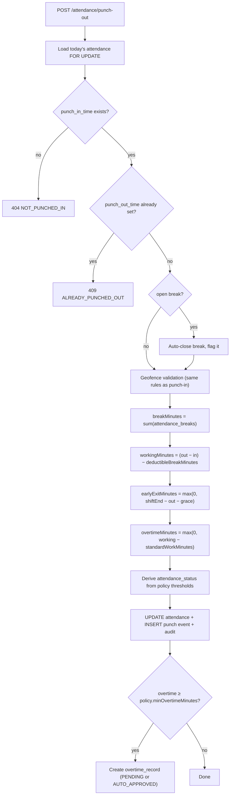
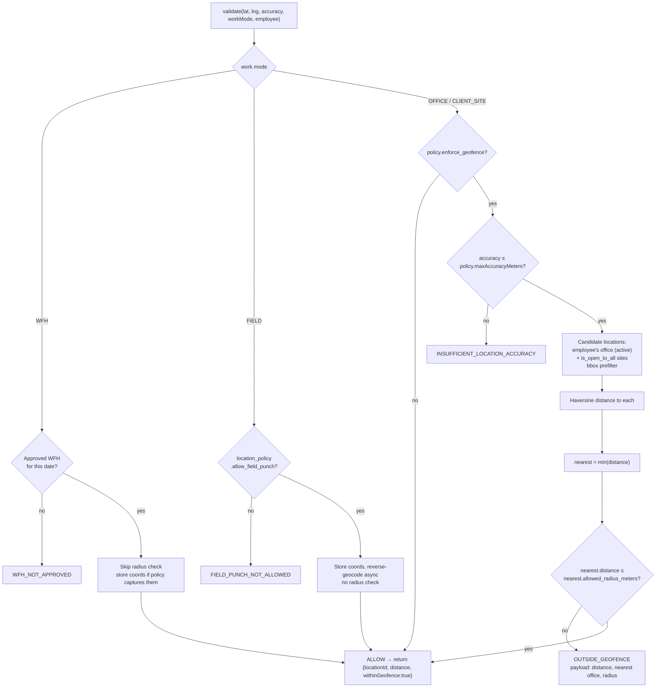
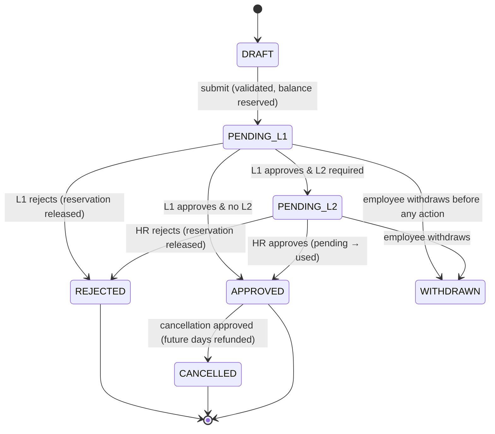

# 04 — Core Workflows

## 4.1 Punch-in

```mermaid
sequenceDiagram
  autonumber
  participant U as Employee (browser)
  participant FE as React SPA
  participant API as AttendanceController
  participant PS as PunchService
  participant GEO as GeofenceService
  participant DB as MySQL

  U->>FE: Click "Punch In"
  FE->>FE: navigator.geolocation.getCurrentPosition<br/>(enableHighAccuracy, timeout 15s)
  alt Permission denied / timeout
    FE-->>U: Explain requirement; offer WFH/Field mode<br/>if policy allows, else block
  else Position acquired
    FE->>API: POST /api/v1/attendance/punch-in<br/>{lat, lng, accuracy, capturedAt, workMode, deviceInfo}<br/>Bearer JWT · Idempotency-Key
    API->>PS: punchIn(principal, request)
    PS->>DB: load employee (from JWT eid), office, timezone
    PS->>PS: businessDate = now @ office zone
    PS->>DB: resolve shift, attendance policy, location policy
    PS->>DB: day type (holiday / weekly-off / approved leave / WFH)
    PS->>PS: punch window check
    PS->>GEO: validate(lat, lng, accuracy, workMode, employee)
    GEO->>DB: candidate office_locations (bbox prefilter)
    GEO-->>PS: matched location + distance, or OUTSIDE_GEOFENCE
    PS->>PS: SuspiciousPunchDetector -> flags
    PS->>DB: INSERT attendance (unique employee_id+date)
    PS->>DB: INSERT attendance_punch_events
    PS->>DB: audit log + late notification (async)
    PS-->>API: AttendanceResponse
    API-->>FE: 200 {success, data}
    FE->>FE: start live timer, invalidate ['attendance','today']
  end
```

### Backend validation chain (order is deliberate — cheapest and most decisive first)

| # | Check | Failure |
|---|---|---|
| 1 | Employee resolved **from JWT** and `is_active`, not exited | `EMPLOYEE_INACTIVE` |
| 2 | Business date computed in the office's timezone | — |
| 3 | Effective shift exists for that date | `NO_SHIFT_ASSIGNED` |
| 4 | Attendance + location policy resolved by scope | — |
| 5 | Day type: holiday / weekly-off → allowed only if policy permits, status flagged | `PUNCH_NOT_ALLOWED_ON_HOLIDAY` |
| 6 | No approved **full-day** leave on this date | `ON_APPROVED_LEAVE` |
| 7 | Punch window: `now ≥ shiftStart − punchInWindowBefore` | `OUTSIDE_PUNCH_WINDOW` |
| 8 | Accuracy `≤ policy.maxAccuracyMeters` (skipped when geofence is not enforced) | `INSUFFICIENT_LOCATION_ACCURACY` |
| 9 | Geofence (see §4.3) | `OUTSIDE_GEOFENCE` |
| 10 | Suspicion flags computed — blocking only if `location_policy.block_on_suspicious` | `SUSPICIOUS_PUNCH` |
| 11 | `INSERT` attendance; unique-violation ⇒ already punched in | `ALREADY_PUNCHED_IN` |

Steps 1–11 run inside one `@Transactional`. The employee id in the request body — if a client sends one — is ignored.

### Derived on insert

```
lateMinutes = max(0, punchInLocalTime − (shiftStart + gracePeriodMinutes))
status      = PUNCHED_IN                    (final status is set at punch-out)
workMode    = request.workMode, validated against policy and approved WFH
```

### Frontend geolocation handling

```ts
// services/geolocationService.ts — contract
getCurrentPosition({ enableHighAccuracy: true, timeout: 15000, maximumAge: 0 })
// PERMISSION_DENIED  -> explain why location is required; link to browser help
// POSITION_UNAVAILABLE -> retry once, then offer regularization path
// TIMEOUT            -> retry with maximumAge: 30000
```

The button stays disabled until a position resolves. Accuracy is shown to the employee before they punch (`Accuracy: ±12 m`), so a bad GPS fix is visible rather than a mysterious rejection.

---

## 4.2 Punch-out, breaks, and status derivation



### Status derivation (thresholds from the resolved policy — no constants in code)

| Condition | Status |
|---|---|
| `workingMinutes ≥ policy.fullDayMinutes` | `PRESENT` |
| `policy.halfDayMinutes ≤ workingMinutes < fullDayMinutes` | `HALF_DAY` |
| `policy.minAttendanceMinutes ≤ workingMinutes < halfDayMinutes` | `INSUFFICIENT_HOURS` |
| `workingMinutes < policy.minAttendanceMinutes` | `ABSENT` |
| No punch at all by end of day, not leave/holiday/weekly-off | `ABSENT` (via `AutoAbsentJob`) |
| `work_mode = WFH` with approved request | `WFH` (hours rules still apply) |

Worked example, 09:20 in → 18:30 out, 45 min break: `550 − 45 = 505` min = **8 h 25 m** → `PRESENT`, overtime `505 − 480 = 25` min.

**Late-mark policy** is separate and cumulative: `LateMarkEvaluator` counts `late_minutes > 0` days in the policy's reset period; every `policy.lateMarksForHalfDay` late marks converts one day to `HALF_DAY`. The conversion writes a new attendance state with a remark — it never rewrites the original punch times.

**Night shifts:** when `shift.is_night_shift`, the attendance row belongs to the **shift start date**. A 22:00 → 07:00 shift punching out at 07:10 the next morning updates yesterday's row. `DateTimeUtils.resolveBusinessDate(employee, instant)` owns this rule; nothing else may compute a business date.

**Missing punch-out:** `AutoPunchOutJob` never invents a punch-out time. It marks the day `MISSING_PUNCH_OUT`, notifies the employee and manager, and leaves regularization as the correction path. Fabricating a time would put unverified data into an auditable record.

### Break flow

`POST /attendance/break/start` → reject if not punched in, if punched out, or if a break is already open → insert `attendance_breaks` + a `BREAK_START` event → status `ON_BREAK`.
`POST /attendance/break/end` → close the open break, compute `duration_minutes`, set `exceeded_limit` when `break_type.max_minutes` or `policy.maxBreakMinutes` is exceeded (flag, not block) → status back to `PUNCHED_IN`.

---

## 4.3 Geofence validation



### Haversine

```java
// GeoUtils.distanceInMeters
private static final double EARTH_RADIUS_M = 6_371_000d;

public static double distanceInMeters(double lat1, double lon1, double lat2, double lon2) {
    double dLat = Math.toRadians(lat2 - lat1);
    double dLon = Math.toRadians(lon2 - lon1);
    double a = Math.sin(dLat / 2) * Math.sin(dLat / 2)
             + Math.cos(Math.toRadians(lat1)) * Math.cos(Math.toRadians(lat2))
             * Math.sin(dLon / 2) * Math.sin(dLon / 2);
    return EARTH_RADIUS_M * 2 * Math.atan2(Math.sqrt(a), Math.sqrt(1 - a));
}
```

Accurate to well under a metre at geofence scale, which is far finer than consumer GPS accuracy (5–50 m). The **bounding-box prefilter** narrows candidates in SQL before any trigonometry:

```sql
WHERE is_active = 1
  AND latitude  BETWEEN :lat - :dLat AND :lat + :dLat
  AND longitude BETWEEN :lng - :dLng AND :lng + :dLng
-- dLat = maxRadius/111320 ; dLng = dLat / cos(radians(lat))
```

**This validation runs in the backend, always.** The React client may pre-check distance to show "You are 340 m from Mumbai Office" before the employee taps the button — that is a courtesy, and the server repeats every check regardless of what the client claims.

### Rejection response

```json
{
  "success": false,
  "message": "You are outside the permitted office location",
  "errorCode": "OUTSIDE_GEOFENCE",
  "data": { "nearestOffice": "Mumbai Office - Tower B", "distanceMeters": 412.7, "allowedRadiusMeters": 200 }
}
```

Telling the employee the distance turns a dead end into an actionable message, and it is not sensitive information — it is their own position relative to their own office.

### Suspicion flags (recorded, not necessarily blocking)

| Flag | Trigger |
|---|---|
| `LOW_ACCURACY` | `accuracy > policy.maxAccuracyMeters` when the check is non-blocking |
| `IMPOSSIBLE_TRAVEL` | distance ÷ time between consecutive punches implies > 900 km/h |
| `IDENTICAL_COORDINATES` | exact lat/lng repeated across N consecutive days (real GPS jitters) |
| `IP_LOCATION_MISMATCH` | IP geolocation country ≠ GPS country |
| `PROHIBITED_REGION` | coordinates outside `location_policy.allowed_countries` |
| `CLIENT_CLOCK_SKEW` | `capturedAt` differs from server time by > 5 min |

---

## 4.4 Leave application and approval



### Application validation

1. Leave type active and applicable — gender rule, `min_service_days` since joining.
2. `from_date ≤ to_date`; back-dating only within `policy.backdatedLeaveWindowDays`.
3. `min_notice_days` satisfied, unless the type is exempt (sick leave usually is).
4. **No overlap** — join `leave_request_days` on `(employee_id, leave_date)` for requests not in `REJECTED/CANCELLED/WITHDRAWN`.
5. Day expansion: build `leave_request_days`, tagging each date `WORKING` / `HOLIDAY` / `WEEKLY_OFF`; `is_deductible` follows `leave_type.counts_holidays_weekly_offs`.
6. `total_days` = sum of deductible portions (0.5 per half day).
7. `max_consecutive_days` not exceeded.
8. Attachment present when `requires_attachment` or duration exceeds `attachment_required_after_days`.
9. **Balance**: `available ≥ total_days`, unless `allow_negative_balance` — else `LEAVE_BALANCE_INSUFFICIENT` with the shortfall in the payload.

Then, in one transaction: reserve (`pending_days += total_days`, optimistic-lock retry once), insert request + days, build the approval chain, publish `LeaveAppliedEvent`.

### Approval chain construction

`ApprovalWorkflowService.buildChain(request)` resolves levels from the hierarchy and policy — not from hardcoded roles:

| Level | Approver | Applies when |
|---|---|---|
| L1 | `PRIMARY` manager from `employee_managers` on the applied date | always |
| L2 | HR business partner, else any `HR` for the office | `total_days > policy.hrApprovalThresholdDays`, or the leave type demands it, or balance goes negative |
| Skip | If the applicant *is* the L1 approver (a manager applying), L1 is `SKIPPED` and routing goes to their own manager | |
| Escalate | `EscalationJob` reassigns to the next level up after `policy.approvalSlaHours` | |
| Delegate | Approver on leave → `delegated_from_employee_id` records the substitution | |

### On final approval (single transaction)

1. `leave_requests.status = APPROVED`, `decided_at` set.
2. Balance: `pending_days −= total_days`, `used_days += total_days`.
3. For each deductible `leave_request_days` row, upsert `attendance` with `attendance_status = ON_LEAVE` (`HALF_DAY_LEAVE` for a half-day portion, which still expects a punch for the working half).
4. `LeaveApprovedEvent` → notification to employee, cc manager.
5. Audit rows for the status change and every balance movement.

Rejection releases `pending_days` and touches nothing else. Cancellation after approval refunds only **future** days — days already consumed stay consumed, which matches how payroll will have read them.

### Balance mechanics

- `LeaveAccrualJob` credits monthly/quarterly/annual per `leave_type.accrual_type`, pro-rated from `joining_date` when `pro_rata_on_joining`.
- `LeaveCarryForwardJob` runs at leave-year end (`company_settings.leave.year_start_month`): carries up to `max_carry_forward_days`, lapses the remainder into `lapsed_days`, and opens next year's rows.
- Every adjustment — accrual, carry-forward, lapse, HR manual adjustment — writes an `audit_logs` row with old and new balance. A leave balance is a ledger; it must always be explainable.

---

## 4.5 Attendance regularization

```mermaid
sequenceDiagram
  participant E as Employee
  participant API as RegularizationController
  participant RS as RegularizationService
  participant M as Manager
  participant DB as MySQL

  E->>API: POST /regularizations {date, requestedIn, requestedOut, reasonType, reason, attachment}
  API->>RS: apply(principal, request)
  RS->>DB: within regularization_window_days? monthly quota left?
  RS->>DB: no other PENDING request for that date?
  RS->>DB: snapshot original punch times + status onto the request row
  RS->>DB: INSERT attendance_regularizations + approval chain
  RS-->>E: PENDING
  M->>API: PUT /regularizations/{id}/approve
  API->>RS: approve(principal, id, comments)
  RS->>DB: verify approver is the current level approver
  RS->>DB: UPSERT attendance (source=REGULARIZATION, is_regularized=true)
  RS->>DB: INSERT synthetic punch events (source=REGULARIZATION)
  RS->>DB: recompute working/late/early/overtime; audit old→new
  RS-->>E: notification: approved
```

The original punch data is **never overwritten**: the pre-change values live on the regularization row, the original punch events remain in the append-only log, and `audit_logs` records the before/after of the attendance row. Any auditor can reconstruct both what the device reported and what was approved instead.

## 4.6 Work-from-home

Apply → validate (no overlapping WFH or leave, within `maxWfhDaysPerMonth`, advance notice) → expand to `wfh_request_days` → manager approval → approved days let punch-in take the WFH branch in §4.3. Attendance for those days shows `WFH`, and the working-hour rules apply exactly as in the office — WFH changes where the location check happens, not whether the day is counted.

## 4.7 Scheduled jobs

| Job | Cadence | Action |
|---|---|---|
| `AttendanceReminderJob` | configurable, e.g. 09:45 | Notify active employees with no punch-in on a working day |
| `AttendanceReminderJob` (out) | e.g. 18:30 | Notify employees punched in but not out |
| `AutoPunchOutJob` | 02:00 | Flag `MISSING_PUNCH_OUT`; never fabricate a time |
| `AutoAbsentJob` | 01:00 | Mark `ABSENT` where no punch, no leave, not holiday/weekly-off |
| `LeaveAccrualJob` | 1st of month, 00:30 | Credit accruals |
| `LeaveCarryForwardJob` | leave-year end | Carry / lapse / open next year |
| `EscalationJob` | hourly | Escalate approvals past SLA |
| `AttendanceSummaryRollupJob` | 03:00 | Rebuild `attendance_monthly_summary` |
| `DataRetentionPurgeJob` | weekly | Purge punch coordinates and audit rows past retention |

All wrapped in ShedLock. All chunked per employee so one bad row cannot fail a whole night's run.
